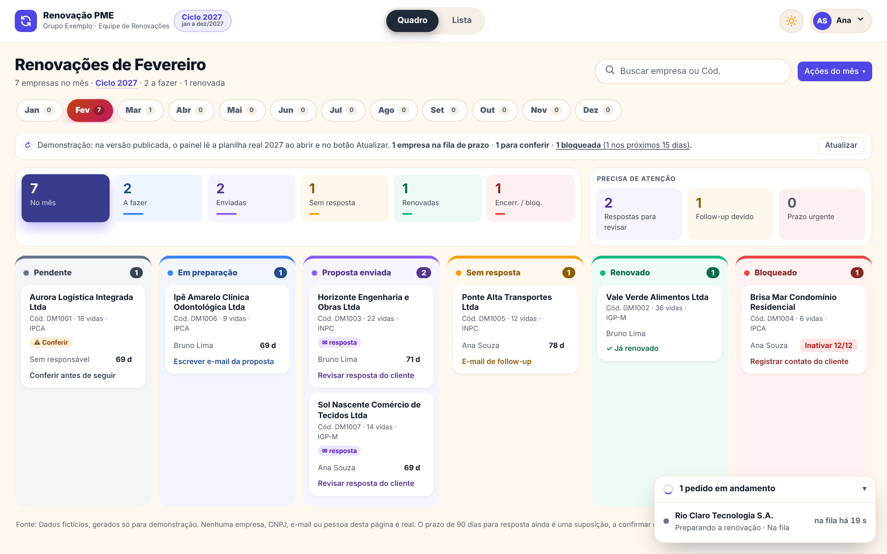
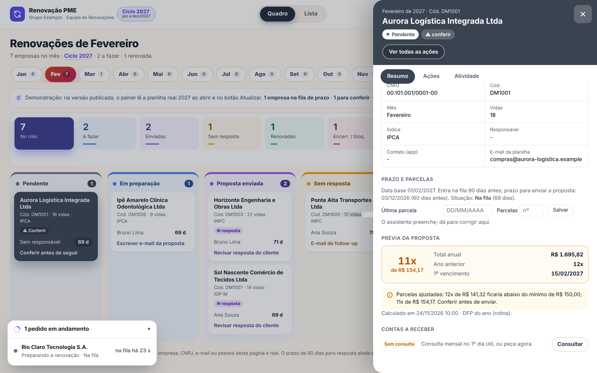
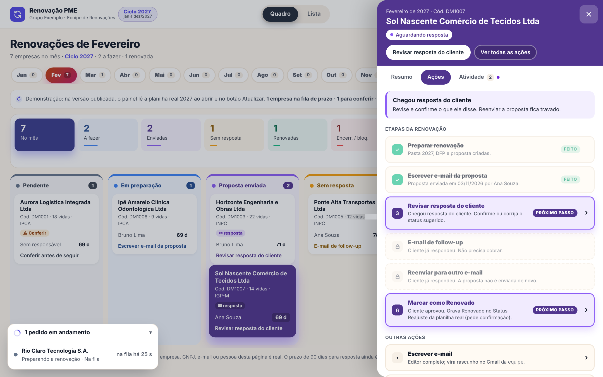
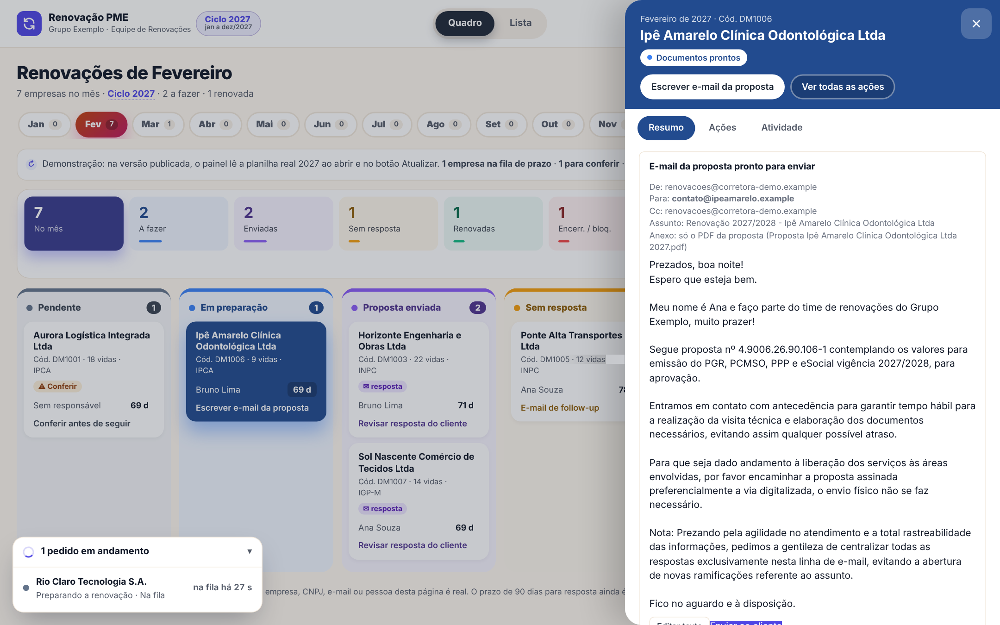
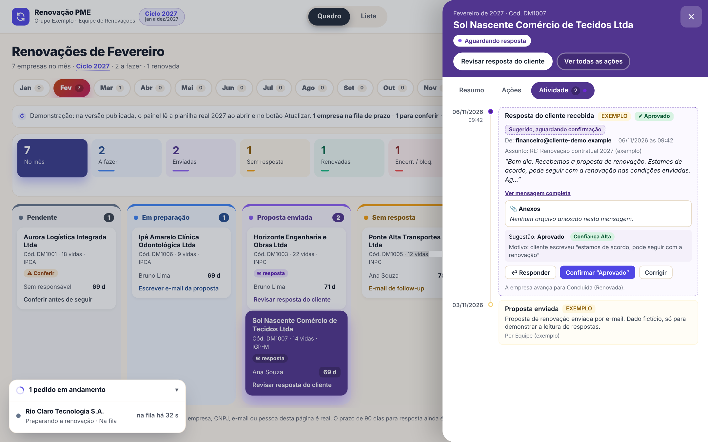
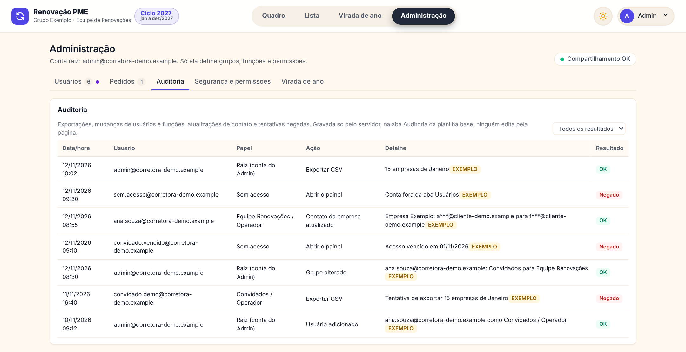
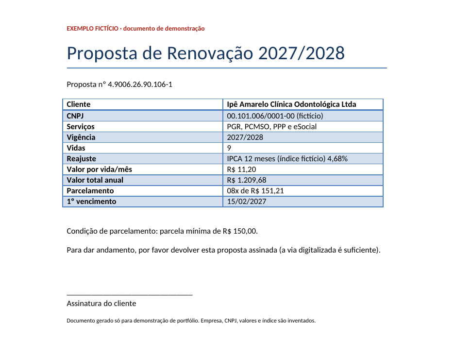
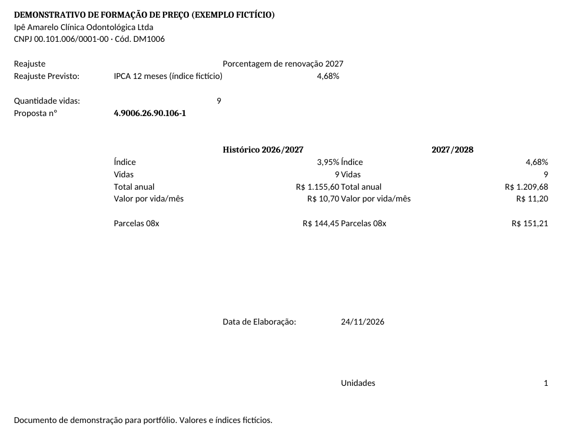

# Olá, sou o Lucas · Hi, I'm Lucas 👋

[🇧🇷 Português](#pt) · [🇺🇸 English](#en)

## 🇧🇷 Sobre mim

Crio **automações com agentes de IA** para tirar trabalho manual e repetitivo do caminho. Idealizo o processo, defino as regras de negócio e a experiência de uso, e construo a solução com IA. Estudo Análise e Desenvolvimento de Sistemas.

### 🚀 Aberto a oportunidades

Busco minha primeira vaga em TI: **IA aplicada e automação**, ou **suporte e infraestrutura**.

### O que eu faço

- Agentes de IA (como o Cursor) para criar e iterar ferramentas e automações
- Automação de rotinas e planilhas (JavaScript, VBA, Python)
- Ferramentas que economizam horas de trabalho manual

### Ferramentas que criei no trabalho

#### 📋 Renovação PME: renovação de contratos ocupacionais

Automação do processo anual de renovação de contratos de saúde ocupacional para pequenas e médias empresas, que era manual, espalhado entre planilhas, sistema e e-mail, e sujeito a erro de cálculo e perda de prazo.

- **Rotina em segundo plano:** lê os contratos, baixa vidas e exames, calcula o reajuste pelo índice do contrato e gera proposta e demonstrativo já conferidos
- **Painel web em Kanban:** acompanha cada empresa até a renovação, cria rascunhos de e-mail para revisão humana, classifica respostas, confere assinaturas e agenda follow-ups
- **Tempo por documento:** de 5–10 min (manual, um a um) para ~1 min
- **Tecnologias:** Google Apps Script, Python, Google Sheets, Drive, Gmail e agente de IA
- Controle de acesso por perfil e trilha de auditoria

| Quadro Kanban | Detalhe da empresa |
|---|---|
|  |  |
| **Etapas da renovação** | **Rascunho de e-mail** |
|  |  |
| **Resposta do cliente classificada** | **Trilha de auditoria** |
|  |  |
| **Proposta gerada** | **Demonstrativo de preço** |
|  |  |

Prints feitos com dados fictícios.

### Projeto pessoal

🎵 **[Mixteca](https://github.com/Necsoz/mixteca)**: organizador de músicas para Windows. Detecta BPM e tom (Camelot), completa tags e capas e organiza em pastas por gênero → BPM → tom. Python, PT/EN.

### Como eu trabalho

Mapeio o processo com quem opera, defino as regras e a experiência de uso, e conduzo agentes de IA para construir. O código é feito com apoio de IA, e eu valido o resultado em casos reais.

### 💬 Fale comigo

📍 Brasil

---

## 🇺🇸 About me

I build **AI-agent automations** that take manual, repetitive work off people's plates. I design the process, define the business rules and the user experience, and build the solution with AI. I'm studying Systems Analysis and Development (a Brazilian software systems degree).

### 🚀 Open to opportunities

Looking for my first role in IT: **applied AI and automation**, or **support and infrastructure**.

### What I do

- AI agents (such as Cursor) to create and iterate on tools and automations
- Automating routines and spreadsheets (JavaScript, VBA, Python)
- Tools that save hours of manual work

### Tools I built at work

#### 📋 PME Renewal: occupational health contract renewals

Automates the yearly renewal of occupational health contracts for small and mid-sized companies, a process that used to be manual, scattered across spreadsheets, a management system and email, and prone to calculation errors and missed deadlines.

- **Background routine:** reads the contracts, pulls headcount and exam data, applies the contract's price index and generates a checked proposal and statement
- **Kanban web dashboard:** tracks each company until renewal, drafts emails for human review, classifies replies, checks signatures and schedules follow-ups
- **Time per document:** from 5–10 min (manual, one by one) to ~1 min
- **Stack:** Google Apps Script, Python, Google Sheets, Drive, Gmail and an AI agent
- Role-based access control and audit trail

| Kanban board | Company details |
|---|---|
|  |  |
| **Renewal steps** | **Email draft** |
|  |  |
| **Classified client reply** | **Audit trail** |
|  |  |
| **Generated proposal** | **Pricing statement** |
|  |  |

Screenshots made with fictional data.

### Personal project

🎵 **[Mixteca](https://github.com/Necsoz/mixteca)**: a Windows music organizer. Detects BPM and key (Camelot), fills in tags and cover art, and organizes folders by genre → BPM → key. Python, PT/EN.

### How I work

I map the process with the people who run it, define the rules and the user experience, and steer AI agents to build. The code is written with AI assistance, and I validate the results on real cases.

### 💬 Get in touch

📍 Brazil
